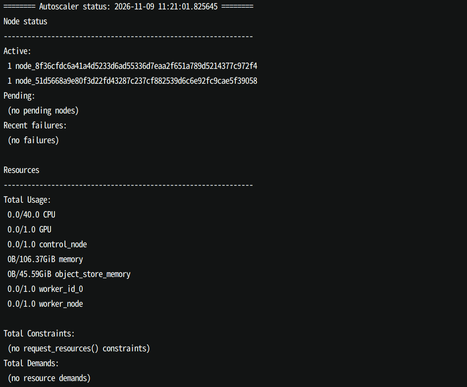
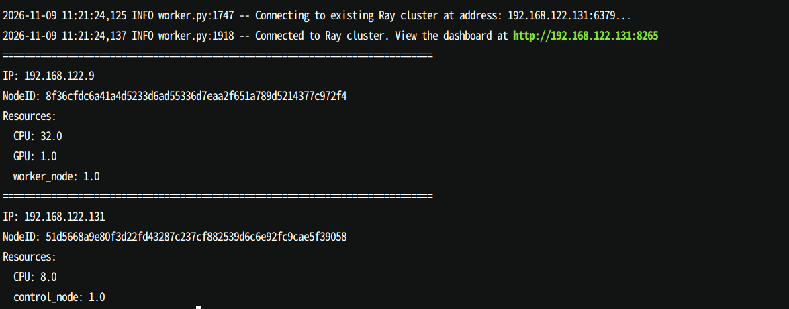
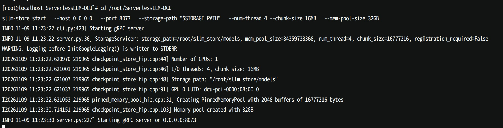
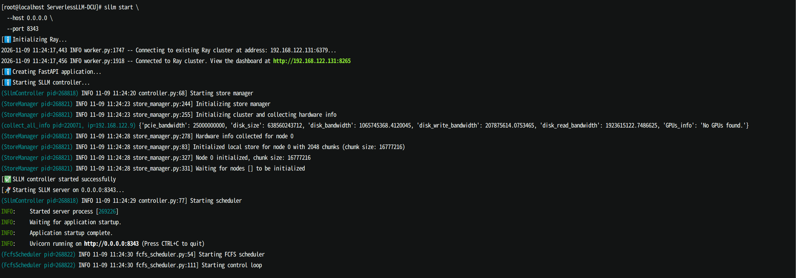
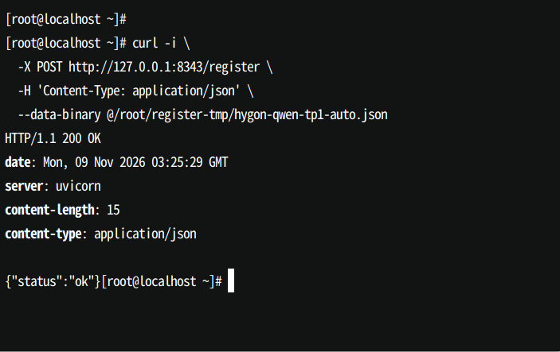
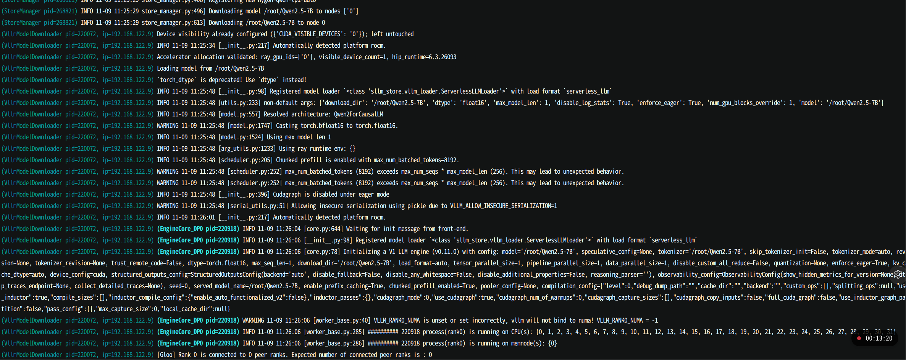
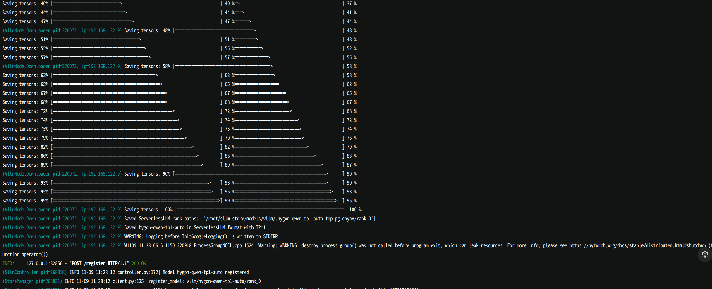
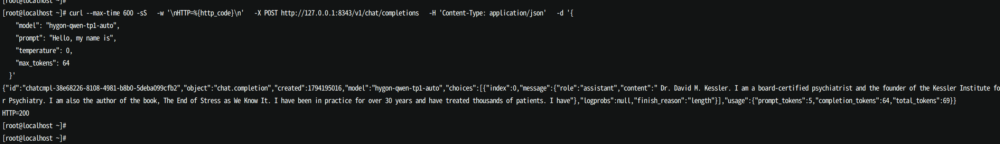
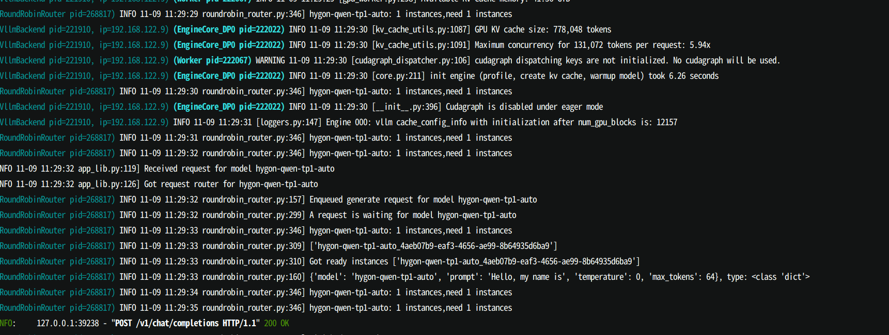

# 海光 DCU 测试与性能验证

在 K100-AI 平台上，以 HuggingFace SafeTensors 标准加载方式作为对比基线，针对Qwen3-32B、Qwen3.6-35B-A3B、Qwen3.8-27B等 27B～35B级大模型开展了加载性能测试。结果表明，在缓存命中的热加载场景下，模型加载速度平均提升约 3.3 倍，提升范围为 2.8～3.7 倍。在模拟 Serverless 冷启动的多副本随机加载场景下，加载速度提升约 1.2～2.4 倍。
测试结果表明，经过适配的 ServerlessLLM 能够有效降低海光 DCU 平台上的大模型加载时延，尤其在缓存命中场景下加速效果明显。

| 模型                            | 场景   | SafeTensors | ServerlessLLM | 提升倍数  |
| :------------------------------ | :----- | :---------- | :------------ | :-------- |
| **Qwen3-32B**                   | Random | 290.4s      | 236.6s        | **1.23x** |
|                                 | Cached | 12.0s       | 3.3s          | **3.65x** |
| **Qwen3.6-35B-A3B**             | Random | 359.8s      | 248.3s        | **1.45x** |
|                                 | Cached | 12.4s       | 3.5s          | **3.51x** |
| **Qwen3.8-27B**                 | Random | 281.9s      | 188.2s        | **1.50x** |
|                                 | Cached | 9.6s        | 2.9s          | **3.29x** |
| **Qwen3-30B-A3B-Instruct-2507** | Random | 291.2s      | 222.3s        | **1.31x** |
|                                 | Cached | 15.7s       | 5.6s          | **2.82x** |

# ServerlessLLM-DCU 简单分布式部署与推理使用指南

## 1. 概述

ServerlessLLM 是一个面向大语言模型推理的 Serverless 服务框架，支持模型动态加载、推理实例管理和资源调度等功能。

ServerlessLLM-DCU 在原有 ServerlessLLM 框架的基础上，针对海光 DCU 平台进行了适配，使其能够在海光异构计算环境下完成模型存储管理、推理实例创建以及模型推理服务部署。

本文以 **Qwen2.5-7B 模型**为例，介绍如何在海光 DCU 环境中，基于 Ray 部署 ServerlessLLM 分布式集群，并完成从服务启动到模型推理的完整流程。

## 2. 硬件环境

### 2.1 软件环境

在开始部署前，需要确保服务器已经完成海光 DCU 基础运行环境的配置，并正确安装 ServerlessLLM 所需依赖。

主要软件依赖如下：

| 组件     | 版本                                           |
| -------- | ---------------------------------------------- |
| 操作系统 | Kylin os 25.04                                 |
| DTK      | 26.04                                          |
| Python   | 3.11                                           |
| PyTorch  | torch-2.9.0（支持海光 DCU 的 PyTorch 版本）    |
| vLLM     | vllm-0.11.0（已完成海光 DCU 适配的 vLLM 版本） |
| Ray      | 2.48.0                                         |

### 2.2 硬件环境

本文使用两台服务器进行分布式部署。

| 节点       | IP 地址         | 角色                   | DCU 资源 |
| ---------- | --------------- | ---------------------- | :------: |
| Controller | 192.168.122.131 | 集群管理与推理服务入口 |    -     |
| Worker     | 192.168.122.9   | 模型存储与推理计算节点 | 1 张 DCU |

其中：

**Controller 节点**

负责运行 Ray Head、ServerlessLLM Controller 等服务，主要承担模型注册、推理请求接收、资源调度及推理实例管理等功能。

**Worker 节点**

负责提供实际计算资源，运行模型存储服务以及 vLLM 推理实例，执行模型加载与推理计算任务。

Controller 与 Worker 之间通过 Ray 集群进行连接和资源管理。

### 2.3 注意

由于 ServerlessLLM 使用 Ray 进行跨节点通信，需要确保 Controller 与 Worker 节点之间网络互通。

在测试环境中，可以临时停止防火墙，以排除防火墙规则对 Ray 集群通信造成的影响：

```bash
systemctl stop firewalld
```

**注意：不建议在生产环境中直接关闭防火墙。**

建议根据部署环境配置相应的网络访问规则，仅允许可信节点访问 Ray 和 ServerlessLLM 所需端口。

## 3. sllm安装

sllm 是 ServerlessLLM 的服务管理组件，负责模型注册、推理实例管理、资源调度及推理请求处理等功能。

在本文的分布式部署示例中，**Controller 节点需要安装 sllm 组件**。

### 3.1 安装方式

在 Controller 节点进入 ServerlessLLM-DCU 项目根目录，执行以下命令：

```bash
cd /root/ServerlessLLM-DCU

pip install -e .
```

### 3.2 离线环境安装

如果部署环境无法访问外部软件源，且已提前安装 ServerlessLLM 所需的全部依赖，可以使用以下命令从本地源码进行安装：

```bash
cd /root/ServerlessLLM-DCU

pip install \
  --no-deps \
  --force-reinstall \
  -v .
```

### 3.3 验证安装

安装完成后，执行以下命令检查  sllm 命令行工具是否可用：

```bash
sllm --help
```

如果能够正常输出命令行帮助信息，说明 sllm 命令行入口已成功安装。

## 4. sllm_store安装

sllm_store 是 ServerlessLLM 的模型存储管理组件，主要负责模型权重存储、管理及加载相关操作，为推理实例的动态创建提供模型数据支持。

在本文的分布式部署示例中，**Worker 节点需要安装并运行 sllm_store 服务**。

关于海光 DCU 环境下 sllm_store 的依赖安装、环境配置及安装验证，请参考：

[**sllm_store 海光 DCU 安装指南**](./sllm_store/README-DCU.md)

完成安装后，可以执行以下命令验证命令行工具是否可用：

```bash
sllm-store --help
```

如果能够正常输出帮助信息，说明 sllm-store 命令行入口已成功安装。

## 5. Ray

ServerlessLLM 使用 Ray 管理分布式计算资源。

在启动 ServerlessLLM 服务前，需要首先建立 Ray 集群，并确保 Controller 和 Worker 节点均成功加入集群。

### 5.1 启动 Controller 节

在 Controller 节点（192.168.122.131）执行以下命令。

首先停止可能存在的旧 Ray 进程：

```bash
ray stop --force
```

进入项目目录：

```bash
cd /root/ServerlessLLM-DCU
```

配置 Python 模块搜索路径：

```bash
export PYTHONPATH=/root/ServerlessLLM-DCU/sllm_store:/root/ServerlessLLM-DCU:$PYTHONPATH
```

启动 Ray Head：

```bash
ray start --head \
  --node-ip-address=192.168.122.131 \
  --port=6379 \
  --dashboard-host=0.0.0.0 \
  --dashboard-port=8265 \
  --num-cpus=8 \
  --num-gpus=0 \
  --resources='{"control_node":1}'
```

本示例中，Controller 不承担模型计算任务，因此将 `--num-gpus`设置为 0。

control_node 是用于节点识别和调度的自定义 Ray 资源标签，并非实际硬件资源。

### 5.2 启动 Worker 节点

在 Worker 节点（192.168.122.9）执行以下命令。

停止旧 Ray 进程：

```bash
ray stop --force
```

配置海光 DCU 加速器类型（用于指定 ServerlessLLM 使用海光 DCU 加速器适配路径）：

```bash
export SLLM_ACCELERATOR=hygon
```

设置模型存储目录：

```bash
export STORAGE_PATH=/root/sllm_store/models
```

创建存储目录：

```bash
mkdir -p "$STORAGE_PATH"
```

启动 Ray Worker：

```bash
ray start \
  --address='192.168.122.131:6379' \
  --node-ip-address=192.168.122.9 \
  --num-gpus=1 \
  --resources='{"worker_node":1,"worker_id_0":1}'
```

### 5.3 验证 Ray 集群状

完成 Controller 和 Worker 启动后，在 Controller 节点执行：

```bash
ray status
```

正常情况下，应能看到两个处于 Active 状态的节点，并显示 CPU、GPU 以及自定义资源信息。



还可以通过 Python 进一步检查节点资源信息：

```python
import ray

ray.init(address="auto")

for node in ray.nodes():
    if not node["Alive"]:
        continue

    print("=" * 60)
    print("IP:", node.get("NodeManagerAddress"))
    print("NodeID:", node.get("NodeID"))

    for name, value in sorted(node.get("Resources", {}).items()):
        if name in {
            "CPU",
            "GPU",
            "control_node",
            "worker_node",
            "worker_id_0",
        }:
            print(f"{name}: {value}")

ray.shutdown()
```



## 6. 启动 ServerlessLLM 服务

### 6.1 启动 Store 服务

ServerlessLLM Store 用于管理模型权重及相关存储资源，为模型加载和推理实例创建提供支持。

在完成 Ray 集群部署后，需要启动 Store 服务。

在 Worker 节点执行：

```bash
cd /root/ServerlessLLM-DCU

sllm-store start \
  --host 0.0.0.0 \
  --port 8073 \
  --storage-path "$STORAGE_PATH" \
  --num-thread 4 \
  --chunk-size 16MB \
  --mem-pool-size 32GB
```

主要参数说明：

| 参数              | 说明                         |
| ----------------- | ---------------------------- |
| `--host`          | Store 服务监听地址           |
| `--port`          | Store 服务端口               |
| `--storage-path`  | 模型存储根目录               |
| `--num-thread`    | Store 数据处理使用的线程数量 |
| `--chunk-size`    | 模型数据传输和处理的分块大小 |
| `--mem-pool-size` | Store 内存池大小             |

上述参数为本次验证环境使用的配置，不代表所有 DCU 环境的最佳参数。

其中，`--mem-pool-size 32GB` 需要根据实际可用系统内存调整，确保不会与其他服务产生严重的内存资源竞争。



### 6.2 启动 Serve 服务

Serve 组件负责对外提供模型注册、推理实例管理及请求处理接口。在 Store 服务启动后，可以启动 Serve 服务。

在 Controller 节点执行：

```bash
cd /root/ServerlessLLM-DCU

sllm start \
  --host 0.0.0.0 \
  --port 8343
```

参数说明：

| 参数     | 说明               |
| -------- | ------------------ |
| `--host` | Serve 服务监听地址 |
| `--port` | Serve API 服务端口 |

启动过程中，Serve 将初始化相应的管理组件，并连接已有 Ray 集群。



## 7. 模型准备与注册

由于本次验证环境部署于内网，无法直接访问 Hugging Face 等外部模型仓库，因此采用**本地模型离线加载**的方式进行测试。

在模型注册前，需要提前准备完整的模型文件，并将其存放至 Worker 节点可访问的本地目录。

本示例使用已提前下载的 Qwen2.5-7B 模型，存储路径为：

```text
/root/Qwen2.5-7B
```

模型文件准备完成后，在 Controller 节点创建模型注册目录：

```bash
mkdir -p /root/register-tmp
```

创建模型配置文件：

```text
/root/register-tmp/hygon-qwen-tp1-auto.json
```

配置内容如下：

```json
{
  "model": "hygon-qwen-tp1-auto",
  "backend": "vllm",
  "num_gpus": 1,
  "auto_scaling_config": {
    "metric": "concurrency",
    "target": 1,
    "min_instances": 1,
    "max_instances": 1
  },
  "backend_config": {
    "pretrained_model_name_or_path": "/root/Qwen2.5-7B",
    "tensor_parallel_size": 1,
    "torch_dtype": "float16",
    "accelerator": "hygon",
    "rocm_path": "/opt/dtk",
    "vllm_use_v1": "1",
    "distributed_executor_backend": "mp",
    "disable_custom_all_reduce": true,
    "trust_remote_code": false
  }
}
```

确保 Serve 服务处于运行状态后，在 Controller 节点执行：

```bash
curl -i \
  -X POST http://127.0.0.1:8343/register \
  -H 'Content-Type: application/json' \
  --data-binary @/root/register-tmp/hygon-qwen-tp1-auto.json
```

注册成功时，API返回：



Controller 节点控制台部分输出日志如下：





## 8. 模型推理验证

模型注册并完成推理实例创建后，可以通过 Serve 提供的 HTTP API 发送推理请求

~~~bash
curl --max-time 600 -sS \
  -w '\nHTTP=%{http_code}\n' \
  -X POST http://127.0.0.1:8343/v1/chat/completions \
  -H 'Content-Type: application/json' \
  -d '{
    "model": "hygon-qwen-tp1-auto",
    "prompt": "Hello, my name is",
    "temperature": 0,
    "max_tokens": 64
  }'
~~~

正常情况下，接口应返回 HTTP 200 状态码，并包含模型生成的文本内容：



在服务端日志中，也可以观察到推理请求进入 Controller、请求路由以及 Worker 推理处理等相关信息



## 9. 注意事项

### 9.1 num_gpus 与 tensor_parallel_size必须匹配

在当前验证的 ServerlessLLM-DCU 实现中，模型注册配置中的：

```json
"num_gpus": 1
```

需要与：

```json
"tensor_parallel_size": 1
```

保持一致。

这是当前 DCU 适配版本中模型资源管理逻辑的配置约束。

例如，使用单卡进行 TP=1 推理：

```json
{
  "num_gpus": 1,
  "backend_config": {
    "tensor_parallel_size": 1
  }
}
```

如果使用两卡进行 TP=2 推理，则需要相应调整为：

```json
{
  "num_gpus": 2,
  "backend_config": {
    "tensor_parallel_size": 2
  }
}
```

### 9.2 注意 Transformers 与 vLLM 的版本兼容性

使用海光 DCU 适配版 vLLM 0.11.0 时，需要搭配 Transformers 4.x 版本，以确保相关接口兼容。若不使用该版本的 vLLM，则不受此特定版本约束，可根据实际使用的推理框架及其依赖要求选择 Transformers 版本。