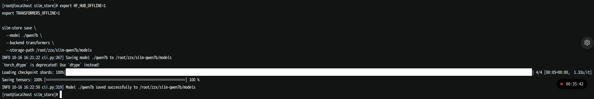
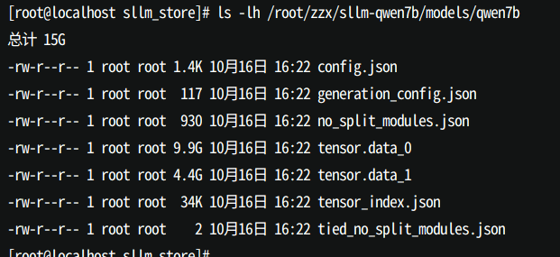
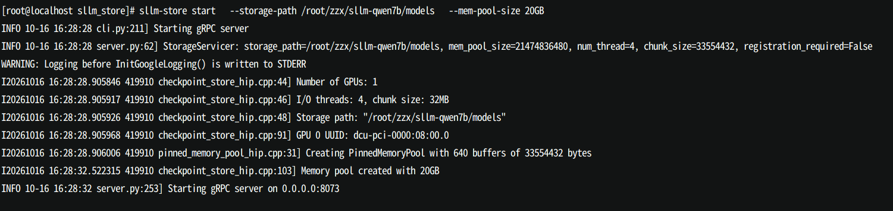
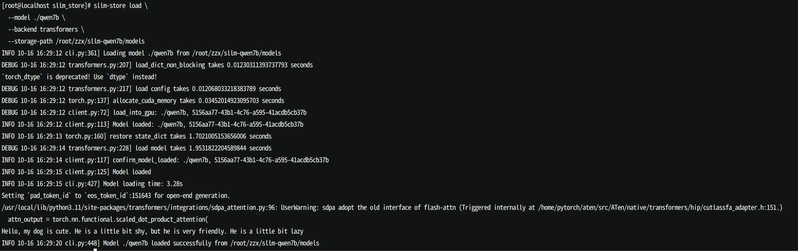
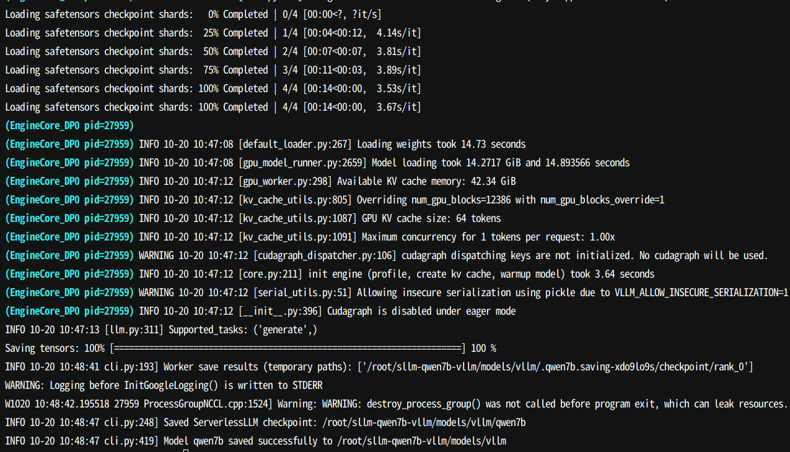
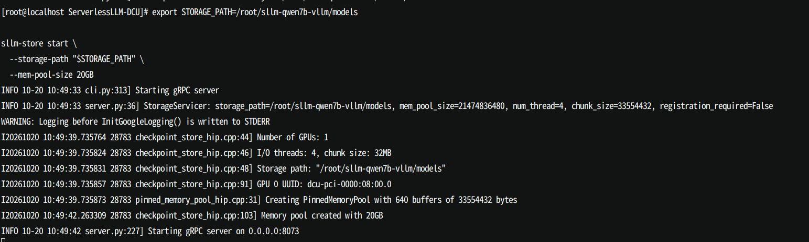
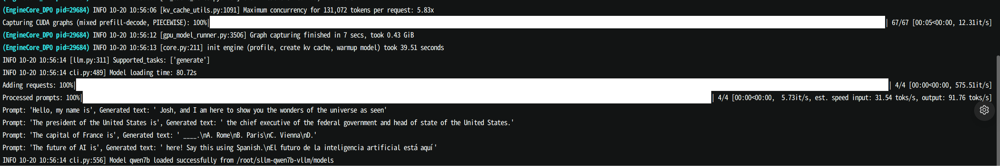

# ServerlessLLM_DCU:sllm_store 组件快速使用

## 安装

进入 sllm_store目录：

```bash
cd ServerlessLLM-DCU/sllm_store
```

### 1. 常规安装

对于能够正常访问软件源及获取构建依赖的环境，可以尝试使用以下方式安装：

```bash
rm -rf build
export USE_DTK=1
python -m pip install .
```

> 注意：该安装方式尚未在当前环境中验证。如果构建过程中出现依赖下载失败，可参考下方离线安装方式。

### 2. 离线安装

对于无法访问外网的环境，可以提前准备 glog和 googletest源码，通过环境变量指定本地依赖路径，避免构建时从网络下载。

```bash
rm -rf build
export USE_DTK=1
export SLLM_OFFLINE_BUILD=1
export SLLM_GLOG_SOURCE_DIR=/xxx/glog
export SLLM_GOOGLETEST_SOURCE_DIR=/xxx/googletest

python -m pip install --no-build-isolation --no-deps -v .
```

其中，`SLLM_GLOG_SOURCE_DIR` 和 `SLLM_GOOGLETEST_SOURCE_DIR` 需要替换为实际的源码目录。离线安装前需确保 Python 构建依赖及编译工具已准备完成。

### 3. 常见依赖问题

#### **gflags 依赖缺失**

在部分环境中，编译 sllm-store时，可能由于 PyTorch/Caffe2 依赖 gflags库而导致 CMake 配置失败，报错如下：

```bash
Could NOT find gflags (missing: GFLAGS_INCLUDE_DIR GFLAGS_LIBRARY)
Your installed Caffe2 version uses gflags but the gflags library cannot be found.
```

如果系统软件源中提供 gflags，可以直接安装：

```bash
yum install -y gflags gflags-devel
```

如果软件源中没有对应的软件包，可以采用源码编译的方式安装。

**1. 获取源码**

```bash
git clone --depth 1 --branch v2.2.2 https://github.com/gflags/gflags.git
cd gflags
```

对于无法联网的环境，可以提前下载源码并上传至目标机器。

**2. 编译安装**

```bash
rm -rf build

cmake -S . -B build \
  -DCMAKE_BUILD_TYPE=Release \
  -DCMAKE_INSTALL_PREFIX=/usr/local \
  -DBUILD_SHARED_LIBS=ON

cmake --build build -j"$(nproc)"
cmake --install build

ldconfig
```

**3. 验证安装**

```bash
ldconfig -p | grep gflags
```

如果能够找到 libgflags.so，说明动态库已被系统识别。

**4. 重新编译 sllm-store**

完成依赖安装后，返回 sllm_store 目录，按照前面的编译安装步骤重新执行安装命令。

如果仍然提示无法找到 gflags，可尝试指定 CMake 搜索路径：

```bash
export CMAKE_PREFIX_PATH=/usr/local:${CMAKE_PREFIX_PATH}
```

## 使用示例

以 Qwen2.5-7B-Instruct 模型为例，介绍在海光 DCU 环境下使用 sllm_store完成模型转换、Store 服务启动、模型加载和推理的基本流程。

### 1. 模型转换

将 HuggingFace 模型转换为 ServerlessLLM 优化存储格式。

**联网环境**

```bash
sllm-store save \
  --model Qwen/Qwen2.5-7B-Instruct \
  --backend transformers \
  --storage-path ./sllm-qwen7b/models
```

**离线环境**

对于无法访问 HuggingFace 的内网环境，可以提前下载模型，通过本地路径进行转换。

~~~bash
#设置离线环境变量：
export HF_HUB_OFFLINE=1
export TRANSFORMERS_OFFLINE=1
#执行模型转换：
sllm-store save \
  --model ./qwen7b \
  --backend transformers \
  --storage-path ./sllm-qwen7b/models
~~~



转换完成后，模型权重将保存至指定的存储目录。

以离线转换为例，执行以下命令查看转换结果：

~~~bash
ls -lh ./sllm-qwen7b/models/qwen7b
~~~

转换后的目录包含 config.json、tensor.data_*、tensor_index.json等文件。本次测试中，Qwen2.5-7B-Instruct 转换后的模型文件总大小约为 15GB。



### 2. 启动 Store 服务

模型转换完成后，启动 Store 服务：

~~~cmd
sllm-store start \
  --storage-path /root/sllm-qwen7b/models \
  --mem-pool-size 20GB
~~~

其中：

- `--storage-path`：转换后模型的存储根目录。
- `--mem-pool-size`：主机侧锁页内存池大小，应根据模型大小和系统可用内存进行调整。

本次测试中，Store 服务成功识别 1 张海光 DCU，创建 20GB 内存池，并启动 gRPC 服务。

部分日志如下：



### 3. 模型加载与推理

保持 Store 服务运行，在另一终端中执行模型加载命令。

**离线环境：**

```bash
sllm-store load \
  --model ./qwen7b \
  --backend transformers \
  --storage-path ./sllm-qwen7b/models
```

**联网环境：**

如果前面使用 HuggingFace 模型名称完成转换，则使用相同的模型名称加载：

```bash
sllm-store load \
  --model Qwen/Qwen2.5-7B-Instruct \
  --backend transformers \
  --storage-path ./sllm-qwen7b/models
```

该命令使用 Transformers 后端加载转换后的模型，并执行 CLI 内置的示例文本生成。

本次海光 DCU 环境下的测试输出如下：



## vLLM 使用示例

以 Qwen2.5-7B-Instruct 为例，介绍在海光 DCU 环境下使用 `sllm_store` 和 vLLM 完成模型转换、Store 服务启动、模型加载及推理的流程。

>我们采用vllm_plugin\vllm_loader的方式去做vllm注册，不再使用打patch的方式，可以直接使用，不用再输入注册代码了

### 1. 模型转换

将 Qwen2.5-7B-Instruct 模型转换为适用于 vLLM 后端的 ServerlessLLM 格式。

**联网环境**

```bash
sllm-store save \
  --model Qwen/Qwen2.5-7B-Instruct \
  --backend vllm \
  --tensor-parallel-size 1 \
  --storage-path /root/sllm-qwen7b-vllm/models
```

**离线环境**

对于已提前下载模型的内网环境，可以通过 `--local-model-path` 指定本地模型路径。

以下以单张海光 DCU 为例：

```bash
sllm-store save \
  --model qwen7b \
  --backend vllm \
  --local-model-path /root/Qwen2.5-7B \
  --tensor-parallel-size 1 \
  --storage-path /root/sllm-qwen7b-vllm/models
```



vLLM 后端生成的模型文件按张量并行 Rank 组织，存储目录与 Transformers 后端不同。

#### 常见问题

##### 模型保存时提示 No module named 'sllm_store._C'

**问题描述**

执行模型保存操作时，可能出现以下错误：

```bash
RuntimeError: Failed to save qwen7b for vllm backend: Call to collective_rpc method failed: No module named 'sllm_store._C'
```

**解决方法**

该问题可能是由于在 `sllm_store` 目录下执行命令，导致 Python 模块导入路径发生冲突。

建议返回项目根目录后重新执行：

```bash
cd ..
```

然后重新运行模型保存命令即可。

> **注意：** 如果切换目录后问题仍然存在，请检查 sllm_store._C扩展模块是否已正确编译和安装。

### 2.启动 Store 服务

模型转换完成后，在独立终端中启动 Store 服务。

```
export STORAGE_PATH=/root/sllm-qwen7b-vllm/models

sllm-store start \
  --storage-path "$STORAGE_PATH" \
  --mem-pool-size 20GB
```

其中，`STORAGE_PATH` 应填写上一步转换结果的实际绝对路径。

`--mem-pool-size` 用于设置主机侧锁页内存池大小，可根据模型大小和系统内存容量调整。

Store 服务启动后，应能够在日志中看到 DCU 设备识别、内存池创建和 gRPC 服务启动信息。



### 3. 模型加载与推理

保持 Store 服务运行，在另一个终端中执行。

**离线环境：**

```
export STORAGE_PATH=/root/sllm-qwen7b-vllm/models

sllm-store load \
  --model qwen7b \
  --backend vllm \
  --storage-path "$STORAGE_PATH"
```

**联网环境：**

```
export STORAGE_PATH=/root/sllm-qwen7b-vllm/models

sllm-store load \
  --model Qwen/Qwen2.5-7B-Instruct \
  --backend vllm \
  --storage-path "$STORAGE_PATH"
```

注意，模型加载时使用的名称必须与转换时 `--model` 指定的名称一致。

该命令会通过 vLLM 加载 ServerlessLLM 格式的模型权重，并执行 CLI 内置的示例推理。



## 海光 DCU 测试与性能验证

在海光 DCU K100_AI 平台上的初步测试表明，ServerlessLLM 在缓存加载场景下相较 SafeTensors 可获得约 2.2x～2.7x 的加载加速，其中 Llama-3.1-8B-Instruct、Qwen3-32B 和 DeepSeek-R1-Distill-Qwen-32B 分别达到 2.22x、2.74x 和 2.66x。

| 模型                         | 场景   | SafeTensors | ServerlessLLM | 提升倍数 |
| :--------------------------- | ------ | :---------- | :------------ | :------- |
| Llama-3.1-8B-Instruct        | Cached | 2.34s       | 1.06s         | 2.22x    |
| Qwen/Qwen3-32B               | Cached | 10.40s      | 3.79s         | 2.74x    |
| DeepSeek-R1-Distill-Qwen-32B | Cached | 11.22s      | 4.21s         | 2.66x    |